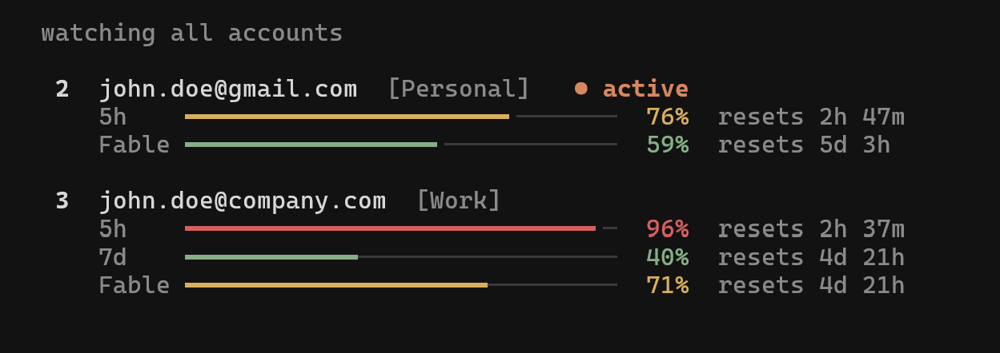

# cswaps

Multi-account switcher for Claude Code, with auto-switching that runs inside one screen. Easily switch between multiple Claude accounts without logging out, or let it switch for you before you hit a rate limit. Track usage for every account in a live dashboard, and run accounts in parallel. Works with both the Claude Code CLI and the VS Code extension.

`cswaps` is a fork of [claude-swap](https://github.com/realiti4/claude-swap) by Onur Cetinkol (MIT). It adds the `optimized` and `priority` strategies, account roles (always first / normal / always last), a safe way to add accounts, auto-switching and self-update inside the `cswaps` screen.

## Installation

Needs Python 3.12 or newer and `git`. The release repository is public: no account and no invitation are needed.

```bash
pip install git+https://github.com/jsk460/cswaps-r
# or isolated:  uv tool install git+https://github.com/jsk460/cswaps-r
#               pipx install git+https://github.com/jsk460/cswaps-r
```

**Ubuntu / Debian:** the system Python refuses `pip install` ("externally-managed-environment"). Use `pipx`, and do not use `--break-system-packages`:

```bash
sudo apt install pipx git
pipx ensurepath          # then open a new terminal
pipx install git+https://github.com/jsk460/cswaps-r
```

Then run `cswaps`. If your machine blocks the launcher program pip creates (an application-control policy shows "This file is blocked"), start it through Python instead: `python -m cswaps` (a module name cannot contain a hyphen, so `python -m` takes the underscore form; `python -m claude_swap` is the same program).

**If the original `claude-swap` is installed, remove it first** (`pip uninstall claude-swap`, `uv tool uninstall claude-swap` or `pipx uninstall claude-swap`). Both write the same files, so installing one over the other leaves a broken mix. Your accounts and settings live in `~/.claude-swap-backup/` and are kept.

Never update with `pip install -U claude-swap`, `uv tool upgrade claude-swap` or `pipx upgrade claude-swap`: those install the original program from PyPI and replace this one.

### From source

```bash
git clone https://github.com/jsk460/cswaps-r.git
cd cswaps-r
pip install -e .
cswaps help
```

### Updating

```bash
cswaps upgrade          # or choose "Update claude-swap" in the cswaps screen
```

See [Updates](#updates) for how it works.

## Usage

### The interactive screen

Run `cswaps` with no arguments. The menu does most things: add accounts, switch, watch usage of every account, turn auto-switching on, and change the language (English / Korean).

### Add your first account

Log into Claude Code with your first account, then:

```bash
cswaps add
```

### Add more accounts

Log in with another account, then:

```bash
cswaps add
```

Do not run `/logout` first: current Claude Code may revoke the refresh token stored for the account you are leaving.

### Switch accounts

Rotate to the next account:

```bash
cswaps switch
```

Or switch to a specific account:

```bash
cswaps switch 2
cswaps switch user@example.com
cswaps switch dev                # or by alias, once set with `cswaps alias 2 dev`
```

Not sure which one? `cswaps list` is the dashboard — every account's 5-hour and 7-day usage and reset times at a glance:

```bash
cswaps list
```

Or let claude-swap auto-pick by remaining quota — `cswaps switch --strategy best` (most quota left) or `--strategy next-available` (skip rate-limited accounts).

**Note:** You usually don't need to restart — on Linux/Windows the new account is picked up automatically, and on macOS after the Keychain cache expires. To apply it instantly, restart Claude Code or reopen the VS Code extension tab. See [Tips](#tips) for the per-platform details.

### Automatic switching

Let claude-swap watch your usage and switch for you. When the active account's 5-hour or 7-day window reaches the threshold (default 90%), it switches to the account with the most quota left — before you hit the limit, and safe to run while Claude Code is working:

```bash
cswaps auto                     # foreground loop, polls every 60s
cswaps auto --threshold 80      # switch earlier
cswaps auto --weekly-threshold 97   # let the weekly window run higher before switching
cswaps auto --model Fable       # also switch when the Fable weekly limit is hit
cswaps auto --once              # single check-and-switch, for cron/scripts
cswaps auto --dry-run           # log what it would do, never switch
cswaps auto --strategy consume-first   # burn the soonest-resetting account first
```

<details>
<summary>How it behaves & advanced usage</summary>

- Runs safely alongside Claude Code: switches take the same credential locks Claude Code uses, so a swap never collides with a token refresh.
- A cooldown (default 5 min) and a hysteresis margin stop it flip-flopping near the threshold: a proactive switch only lands on an account that's below the threshold *and* better than the current one by the margin — a candidate that clears the margin is always taken, but two accounts hovering at the line never ping-pong. When every account is exhausted it keeps checking on a bounded slow cadence, waking sooner for an imminent reset.
- **Strategies** (`--strategy`, or `cswaps config set autoswitch.strategy`): `best` (default) stays put until the active account nears its limit, then moves to the account with the most quota left. `consume-first` proactively keeps you on the account whose **weekly window resets soonest** — use-it-or-lose-it — switching to a sooner-resetting account (with room to spare) even below the threshold, so perishable weekly quota isn't wasted. `priority` always uses the lowest slot number that has room, and returns to it as soon as it frees up (it comes back only while that account is at least 2 points below the threshold, so it never ping-pongs at the line).
- `optimized` ranks accounts by **urgency**: the weekly quota an account would lose per hour if left unused (percent left ÷ hours to the weekly reset). Unlike `consume-first`, it ignores an account that resets first but has almost nothing left to lose. Below the threshold it only moves to an account at least 1.5× as urgent as the current one.
- **Account order.** Three groups, and the order inside two of them is yours: *always first* accounts are used before everything else, in the order you list them, and are returned to the moment one has room again; *normal* accounts (the default) are ordered automatically by the `optimized` rule; *always last* accounts are used only when nothing else has room, in the order you list them. Set it in the screen (`cswaps` → Auto-switch settings → Account order: Enter changes a role, `u` / `d` use an account earlier / later) or with `cswaps config set autoswitch.first 1,me@example.com` and `autoswitch.fallback 3` (slot numbers and/or emails, comma-separated; the order of the list is the order of use). Names that match no managed account are ignored. The automatic return to an earlier group works with every strategy except `best`.
- **Your own switch wins.** If you switch accounts by hand, auto-switch keeps the account you chose until it is used up: it will not "return" to an always-first account or move to a more urgent one in the meantime. A limit still moves you on, and doing so ends the hold (so the next return to an always-first account works as usual). The engine notices a manual switch because the active account is neither the one it last saw nor the one it last switched to; the first time it sees an account proves nothing, so there is no hold then. The status line says `your choice (no automatic move until it is used up)`.
- **A separate line for the weekly windows** (`--weekly-threshold 97`, or `cswaps config set autoswitch.weeklyThreshold 97`): one threshold compared against the busiest window forces the same number on windows that want different ones — the 5-hour window recycles in hours (an overshoot costs one interrupted turn), while the weekly window is the budget (quota unspent before its reset is gone). With a weekly line, the 7-day window and any per-model window (`--model`) are judged against it and the threshold keeps governing the 5-hour window; every window is compared against its own line, so 7d 93% under a 97 line holds while 5h 95% under an 85 line switches, and the log names the window it measured (`7d 93% < 97%`). Points on different windows are not the same amount of work — the lines are comparable, the clocks are not.
- Usage polling is adaptive — a couple of accounts per check, busy alternates watched more closely, and exhausted ones checked about every ten minutes (or slower after 429s) — so API traffic stays flat no matter how many accounts you manage.
- It fails safe: if a usage check errors it keeps trusting the last-known numbers while retries back off, and an expired token on an idle machine makes it hold rather than fail over (Claude Code refreshes the token on your next message).
- An account whose refresh token has died is quarantined and reported until you either log in with it and re-run `cswaps add --slot N`, or replace its stored credentials from a known-good export — a plain `cswaps import backup.cswap` replaces dead-token slots on its own (`--force` is still required to replace other existing accounts; note a stale export can carry an already-superseded token). API-key accounts are never rotated onto unless you pass `--include-api-key-accounts`.
- To hold an account out of rotation yourself — a work account you don't want touched, one you're resting — run `cswaps disable <num|email>`; `cswaps enable <num|email>` puts it back. Disabled accounts are skipped by auto-switch, bare `cswaps switch`, and the `best` / `next-available` strategies, but stay fully managed and remain a valid explicit `cswaps switch <num|email>` target. They show a `(disabled)` marker in `cswaps list`, in the [TUI](#interactive-dashboard-tui), and in the [menu bar](#menu-bar-macos) — both of which also let you toggle the state in place (TUI: menu → *Disable / enable account…*; menu bar: *Disable / enable account*).
- **Per-account threshold.** `cswaps threshold <num|email> <pct>` gives one account its own switch-away line (50–99.9) in place of the global one: auto-switch leaves that account when *its* line is reached and prefers candidates still under *theirs*, with ranking and the hysteresis margin counting room under each account's own line rather than raw headroom. Like the global threshold it is a switch-away line, not a hard cap — with nothing under its line, or the active account at its limit, it still lands somewhere rather than stall. With a weekly line set, the override applies to the 5-hour window only. Accounts without one keep the global threshold. `cswaps threshold` alone lists the default and every override, `--unset` clears one, and the [TUI](#interactive-dashboard-tui) shows a `th 85%` badge.
- By default only the account-wide 5h/7d windows drive switching. If you work on one model and hit its **weekly per-model limit** first (e.g. Fable), add `--model Fable` (or `cswaps config set autoswitch.model Fable`) to fold that model's window into the decision, so it switches off an account whose model quota is spent even while its 5h/7d windows still have room.
  - **Model names** are Anthropic's own per-model `display_name`s, matched case-insensitively. The exact strings for your accounts are the per-model rows in `cswaps list` (e.g. a line reading `Fable: 100%`).

For cron/systemd timers, `--once` reports the outcome in its exit code (`0` switched, `1` error, `2` nothing to do, `3` blocked — no viable target), and `--json` emits one JSON event per line:

```bash
*/5 * * * * cswaps auto --once --json >> ~/.cswap-auto.log 2>&1
```

Defaults like the threshold and cooldown are configurable with `cswaps config set autoswitch.threshold 80` — flags override them (see [Configuration](#configuration)).

</details>

### Run multiple accounts at the same time (session mode)

Launch Claude Code as a specific account in the current terminal only — every other terminal and the VS Code extension stay on your default account, so two accounts can work in parallel.

```bash
cswaps run 2                     # launch Claude Code as account 2, here only
cswaps run user@example.com      # by email
cswaps run 2 -- --resume         # everything after '--' is forwarded to claude
cswaps run 2 --share-history     # share your chat history with this account too
cswaps run 2 --require-session   # refuse rather than run plain claude if 2 is the default login
```

Sessions use your normal `~/.claude` setup (settings, CLAUDE.md, skills, MCP servers, etc.), but each account keeps its own chat history — pass `--share-history` if you want your accounts to continue the same conversations.

Running the account that is already your default login launches plain `claude` on that login instead of a session (a second copy of the active credential would go stale). Scripts that need the isolation guaranteed can pass `--require-session`, which refuses in that case instead.
  
A session refreshes its own copy of the account's token, so once it exits, the credential it rotated is captured back into the account's stored backup before a switch or usage check uses that backup. While a session is still running, `cswaps switch` refuses to move the default login onto its account if the stored backup has already fallen behind (activating it could only fail); exit the session first, or pick another account. While a session runs, its account's usage is read with the session's own credential and never refreshed by cswaps; a read the server refuses shows as token expired, and is not requested again, until the session renews the credential on its next call.

<details>
<summary>Sharing details — MCP servers & chat history</summary>

- With `--share-history`, a session started under one account shows up in `--resume` under the others, and nothing already saved is lost.
- User-scope MCP servers (`claude mcp add -s user`) are mirrored from your default profile on every launch — manage them there; changes made inside a session don't persist. Definitions are copied as-is (including inline `env`/`headers` values), but MCP OAuth logins are not — HTTP servers may ask you to authenticate once per profile via `/mcp`.
- `--no-share` turns sharing off and removes the mirrored MCP config (profiles that never mirrored are left alone).

</details>

<details>
<summary>Map accounts to directories — auto-pick per repo</summary>

Bind a directory to an account, and a bare `cswaps run` there launches that account in session mode — e.g. work account in work repos, personal elsewhere:

```bash
cswaps map 2 ~/work/client-app   # map a directory to account 2
cswaps map user@example.com      # map the current directory
cswaps map                       # list mappings
cswaps unmap ~/work/client-app   # remove one (defaults to current directory)

cd ~/work/client-app/src
cswaps run                       # → account 2, session mode
```

Subfolders inherit the nearest mapped ancestor. In an unmapped directory, `cswaps run` just launches plain `claude` with your default login. Mappings are per-machine (not part of `cswaps export`) and are cleaned up when their account is removed.

</details>

### Interactive dashboard (TUI)

Run `cswaps` on its own (or `cswaps tui`) for the full-screen dashboard: live usage for every account, switching, and the auto-switcher, all keyboard-driven. `cswaps watch` opens it straight to the live monitor. Works on macOS, Linux, and Windows.



### Refresh expired tokens

If an account's token expires, log back into Claude Code with that account and re-run:

```bash
cswaps add
```

This will update the stored credentials without creating a duplicate.

### Other commands

```bash
cswaps run 2                     # Run an account in this terminal only (session mode)
cswaps auto                      # Auto-switch when nearing rate limits (see above)
cswaps config                    # Show or edit settings (see Configuration below)
cswaps list                      # Show all accounts with 5h/7d usage and reset times
cswaps list --token-status       # Add source-labelled OAuth token diagnostics
cswaps status                    # Show current account
cswaps add --slot 3              # Add account to a specific slot (prompts before overwrite)
cswaps add --alias dev           # Add account and give it a short alias
cswaps remove 2                  # Remove an account
cswaps disable 2                 # Hold an account out of auto-rotation (keeps its login)
cswaps enable 2                  # Return a disabled account to rotation
cswaps threshold 2 85            # Switch away from account 2 at 85%, not the global default
cswaps threshold 2 --unset       # Return account 2 to the global default
cswaps threshold                 # Show the global default and every per-account override
cswaps alias 2 dev               # Give an account a short alias (usable anywhere NUM|EMAIL is)
cswaps alias 2 --unset           # Remove an account's alias
cswaps alias                     # List all aliases
cswaps move 2 1                  # Assign an account to a slot (relocates to an empty slot, swaps if taken)
cswaps unclaimed                 # List stashed credential entries (slot + why they were stashed)
cswaps unclaimed --purge ID      # Drop one (deletes its bytes; recover with /login + `cswaps add`)
cswaps tui                       # Interactive dashboard (also: bare `cswaps`)
cswaps watch                     # Dashboard, opened on the live watch page
cswaps upgrade                   # Upgrade claude-swap to the latest version
cswaps purge                     # Remove all claude-swap data
```

The original flag spellings (`cswaps --switch`, `cswaps --list`, ...) keep working.

### One command: `cswaps`

Run `cswaps` and leave the screen open. It is the only command most people need:

- **Auto-switching runs while the screen is open.** The first time, it asks once whether to turn it on; the answer is saved (`autoswitch.autoStart`: `ask`, `on`, `off`). The menu shows the status and turns it on or off. Open *Auto-switch view* to watch it; the view takes the engine over and hands it back when you leave.
- **Settings are menus.** *Auto-switch settings* covers the account order (always first / automatic / always last) and the threshold. There is no strategy to pick: accounts you do not pin are ordered by the `optimized` rule (the `autoswitch.strategy` setting still exists for developers).
- **Resets are spelled out.** The active account shows when each window resets with weekday, clock and time left (`5h Mon 14:00 · in 47m   7d Tue Oct 27 06:00 · in 16h 47m`); an account that is out of quota shows when it is back, and the status line says which account `cswaps` is waiting for. From one day away the time left also comes in hours (`5d 5h (125h)`).
- **Claude Code on the web (Remote Control).** On first launch `cswaps` asks once whether to connect your Claude Code sessions to claude.ai/code automatically. *Auto-switch settings → Claude Code on the web* then offers **auto** (the default answer: on while a personal Pro/Max account is active, left to your organization while a Team/Enterprise account is active, and kept in step with every switch — the plan is read from the login's `organizationType`), or a fixed **on**, **off** or **default**. It sets `remoteControlAtStartup` in `~/.claude/settings.json`; other keys are kept, a copy of the original is saved once as `settings.json.cswaps-backup`, a file that is not valid JSON is never touched, and a value you already set in Claude Code is respected. New sessions connect under the account that is logged in when they start. **A session that is already open keeps its old connection after a switch: type `/rc` in it, which starts a new Remote Control session under the current login (the old one stays on the previous account's list, offline).** Claude Code has no hook or flag to do that for you, so switch notices remind you when this is on. Team/Enterprise organizations must have Remote Control enabled by an Owner.
- **A leftover throwaway-login folder is ignored.** Logging in by hand to add an account means pointing `CLAUDE_CONFIG_DIR` at a temp folder named `cswap-login`. If that variable stays set in a terminal, a switch would be written into the temp folder and never reach the login Claude Code really uses: the switch "succeeds" and nothing changes. `cswaps` now drops such a variable (only a `cswap-login*` folder directly in the system temp folder, so nobody's real profile is affected) and says so — a warning on the command line, a notice and a line on the screen. The login helper (*Add account → Log in separately*) is exempt for its own child processes. Prefer that helper to the manual way. A program cannot change the environment of the window that started it, so the value stays in that window until you clear it (Claude Code started from that window would use the throwaway folder too and show "no credentials"). The command-line notice therefore prints the fix for PowerShell, cmd and bash, each on a line of its own so it can be pasted as it is; on the screen, *Copy the fix command* (first in the menu while the notice applies) puts the PowerShell command on the clipboard (`clip`, `pbcopy`, `wl-copy`/`xclip`/`xsel`, else the terminal's own clipboard sequence), then leave with `q`, paste it and press Enter. Because the dropped variable means `cswaps add` would register your *real* login instead of the throwaway one, `add` refuses to run in that state (it says why and what to do). Throwaway folders also hold a copy of a login, so every start (and every use of the login helper) deletes `cswap-login*` folders in the temp folder that nothing has touched for 30 minutes; a folder in use, a link, or a folder that cannot be deleted is left alone and tried again next time.
- **Check logins** (menu, or `cswaps check [--json]`) asks the server whether each stored login is still accepted. `list --token-status` judges a login by its clock only, so a login the server has revoked (by `/logout`, or by a new login of the same account) still reads "fresh". The check is read-only: one `GET /api/oauth/profile` per login with the access token, never a refresh (that rotates the token), a write, or a switch. It tells the answers apart: accepted (and whose login it is, so a slot holding someone else's login is caught), refused although not expired (**revoked**), and "could not check" for the network, a rate limit or a server error, which is never reported as broken. A login whose access token has already expired is not sent (only refreshing could tell). It also reports: Claude Code with no login at all (terminals show "Login expired" / "no credentials"), a config file naming one account over another's credentials, an unmanaged login in use, one login stored under two slots, a login that ends within a week, a quarantined account, throwaway login folders in the temp folder, and a redirected `CLAUDE_CONFIG_DIR`. Each problem comes with the fix. The exit code is 1 when a problem was found.
- **Auto-switch never activates a revoked login.** Before it switches onto a stored login whose access token has not expired, the engine makes the same read-only request. A login the server refuses is quarantined and skipped, and the same tick moves on to the next candidate (a better tier is tried first, a worse one only when the better accounts fail), so the user is not left on "Login expired" while every gauge looks normal. A login that answers as a different account is quarantined too. An answer that says nothing (no network, a rate limit, a server error) never blocks a switch. A dry run asks nobody.
- **Adding an account is a menu** (*Add account → Log in separately*), and so is updating.

Closing the screen stops auto-switching. For a terminal-free setup, run `cswaps auto` under a service manager instead.

### ChatGPT (Codex) accounts

`cswaps` can also keep several **ChatGPT logins for Codex** and switch between them, with their usage in the same screen. Claude accounts switch with Claude accounts, ChatGPT accounts with ChatGPT accounts; the two are separate. Only ChatGPT sign-in is covered, not API keys.

In the menu: **Add ChatGPT account…** and **ChatGPT accounts…**. The "watch all accounts" screen shows a ChatGPT block under the Claude accounts. Press `S`, move down past the last Claude account, and press Enter to switch Codex.

```bash
cswaps codex                       # accounts with usage
cswaps codex add                   # store the Codex login that is in use now
cswaps codex add-safe              # log in to ANOTHER account; the login in use stays
cswaps codex add-safe --device-auth   # same, with a code (SSH, a server)
cswaps codex switch [N|email]      # next account, or the one named
cswaps codex remove N|email        # forget a stored account
cswaps codex auto on 95            # leave an account at 95% of its fullest window
```

What to know:

- **Never run `codex logout` or a bare `codex login` to switch.** Each ChatGPT account has one live refresh token; logging out or in revokes it on the server, and the copy `cswaps` stored dies with it. Use `add-safe`: it logs in inside a throwaway folder.
- **A switch is refused while Codex is running** (use `--force` at your own risk). A running Codex rewrites its login file when it exits and would undo the switch. Auto-switch waits for Codex to close and tells you so.
- Usage is read from an undocumented ChatGPT endpoint (the one the Codex apps use). It can change without notice; the screen then shows "usage cannot be read now" instead of failing.
- If Codex keeps its login in the system keychain (`cli_auth_credentials_store = "keyring"` or `"auto"` in `~/.codex/config.toml`), there is no `auth.json` to copy. Set it to `"file"` and log in again.
- Switching works on Windows. Linux and macOS are not tested yet.
- Reset tickets are shown with their expiry dates; `cswaps` never redeems them.

### Updates

This build updates from its own git repository, never from PyPI (PyPI's `claude-swap` is the upstream project and would replace these changes). On launch, `cswaps` compares its installed commit with the head of the update branch and, when a newer build exists, adds *Update claude-swap…* to the top of the menu. `cswaps upgrade` does the same from the command line.

An update closes the screen, installs the new version, checks that it loads, **puts the previous version back if it does not**, and restarts `cswaps`. On Windows this runs in a new console window, because a running `cswap.exe` cannot be replaced. Accounts and settings live in `~/.claude-swap-backup/` and are not touched.

- Needs `git` and `pip` on the machine, and read access to the repository.
- A development install (`pip install -e`) never updates itself; use `git pull`.
- To use another repository or branch (for example a company GitLab), set `CSWAP_UPDATE_REPO` and `CSWAP_UPDATE_REF`. The repository's default branch (`HEAD`) must exist, or installing a previous commit fails.

### Releasing (maintainer)

Users do not read the development repository. They read a **public release repository** (`cswaps-r`, branch `stable`), which holds one commit per release with only the files an install needs (`src`, `assets`, `LICENSE`, `README.md`, `pyproject.toml`). Development history, tests and tools stay private. Work happens on `dev`; `stable` only ever moves forward, to the tip of `dev`, when you publish. `tools/release.py` (not published) does the steps:

```bash
python tools/release.py check      # what is new upstream, what is not published yet
python tools/release.py merge      # merge the newest upstream release into dev
python tools/release.py verify     # the tests (add --e2e: a real install, update and rollback)
python tools/release.py publish    # tag, push dev, move stable, add a commit to the release repository — asks first
python tools/release.py mirror     # only the last step, if it failed
```

One-time setup: `git remote add release https://github.com/jsk460/cswaps-r.git`.

- Upstream is **merged, never rebased**. Rebasing rewrites commits, so a force-push would leave the commit a user started from unreachable and a failed update could not roll back. Every release also gets a tag (`r1`, `r2`, …), which keeps old builds reachable.
- The release repository is **never force-pushed**, for the same reason.
- Release commits use a `noreply` author address, so no personal address is published.
- `merge` stops on a conflict and lists the files; fix them, commit, then `verify`.
- `publish` runs the tests first and asks you to type `publish`. Users get the new build the next time they open the program.
- The release repository's default branch must be `stable`, or rolling back to a previous commit fails.

### Adding an account without touching the live login

Logging in over a registered account's live login can make Claude Code revoke that account's refresh token. To add or recover an account safely, log in separately:

```bash
cswaps add-safe              # opens a browser; sign in with the account to add
cswaps add-safe --slot 2     # re-register slot 2 (e.g. after "re-login needed")
```

It logs in inside a throwaway profile (`CLAUDE_CONFIG_DIR` set to a temp folder), registers it with `cswaps add`, and deletes the folder. The same action is in the TUI: *Add account… → Log in separately (safe, keeps current login)…*. Needs the `claude` command on your `PATH`.

## Tips

- **Do you need to restart after switching?** Usually not. On **Linux and Windows**, credentials are stored in a file and Claude Code re-reads them whenever that file changes, so the new account takes effect on your next message — no restart needed. On **macOS**, credentials live in the Keychain, which Claude Code caches for about 30 seconds; a running session picks up the switch once that cache expires. Restart Claude Code (or close and reopen the VS Code extension tab) only if you want the change to apply instantly.
- **Continuing sessions after switching:** You can keep using the same Claude Code session after switching — run `cswaps switch` in any terminal and carry on. If you'd prefer a clean start, close and reopen Claude Code (or the VS Code extension tab) and use `--resume` to pick your previous session. Either way, the first message on the new account may use extra usage as its conversation cache rebuilds.

## How it works

- Backs up OAuth tokens and config when you add an account
- Swaps only the account-specific Claude login when you switch accounts;
  live account-independent OAuth state (such as MCP server logins) is
  preserved instead of being overwritten by a slot's older snapshot
- Account credentials stored securely using platform-appropriate methods
- Switches (manual and automatic) hold Claude Code's own credential locks while writing, so a swap never interleaves with a token refresh
- Auto-switch freshens a target's token before activating it, and quarantines accounts whose refresh token has died (recover by re-adding it with `cswaps add --slot N`, or by replacing its stored credentials from a known-good export — a plain `cswaps import backup.cswap` replaces dead-token slots automatically)
- Usage numbers refresh every few minutes — faster for an account being used or close to switching, slower for idle ones — keeping cswaps comfortably inside Anthropic's rate limits however many dashboards you keep open on a machine. An age note like `· 6m ago` just means the next scheduled check hasn't come yet, not that something is stuck.

## Data locations

| Platform | Credentials | Config backups |
|----------|-------------|----------------|
| Windows | File-based (inside the backup directory, under `credentials/`) | `~/.claude-swap-backup/` |
| macOS | macOS Keychain | `~/.claude-swap-backup/` |
| Linux / WSL | File-based (inside the backup directory, under `credentials/`) | `${XDG_DATA_HOME:-~/.local/share}/claude-swap/` |

Session-mode profiles (`cswaps run`) live under the backup directory in `sessions/`. Tool preferences (`settings.json`) and auto-switch state (`autoswitch_state.json` — cooldown and quarantined accounts; delete it to reset) live in the backup directory root.

On Linux/WSL, set `XDG_DATA_HOME` to override the default location.

## Menu bar (macOS)

<details>
<summary>Optional macOS menu bar app — usage at a glance, click to switch</summary>

Needs the `menubar` extra (macOS only):

```bash
uv tool install 'claude-swap[menubar]'   # or: pipx install 'claude-swap[menubar]'
cswaps menubar
```

Shows every account's 5h / 7d / spend usage and switches with a click (specific / rotate / best / next-available), plus the TUI's add / disable-enable / remove / refresh actions. Enable *Settings → Auto-switch accounts* to run the same engine as [`cswaps auto`](#automatic-switching) in the background; it shares the `autoswitch.*` settings, so the menu bar and CLI stay in sync. Off until you turn it on.

The icon is owned by a small wrapper bundle, `/Applications/claude-swap Menubar.app`, that `cswaps menubar` builds (and refreshes after upgrades) on every start before hopping into it. That gives the process the bundle identifier `com.claude-swap.menubar`, which is what menu bar managers (Dimble, Ice, Bartender, SaneBar) key on to list, hide and order an icon; a bare Python process has none and is invisible to them. It has to be `/Applications`: macOS resolves a status item's owner from the app's location, and for an app anywhere else the item's identity is nil, so the first time a manager hides anything the icon goes down with it. If `/Applications` is not writable the bundle lands in the data directory and you get a one-line warning. Set `CLAUDE_SWAP_NO_BUNDLE=1` to run in the plain interpreter instead.

**Keep it running without a terminal.** `cswaps menubar` runs in the foreground, so the status item dies with the terminal that started it and does not come back after a reboot. `--install-service` hands it to launchd instead — starts at login, restarts on crash:

```bash
cswaps menubar --install-service     # start now, and at every login
cswaps menubar --service-status      # installed? loaded? pid?
cswaps menubar --uninstall-service   # stop it and remove the plist
```

The agent lives at `~/Library/LaunchAgents/com.cswap.menubar.plist` and logs to `~/Library/Logs/com.cswap.menubar.{log,err}`. It pins the `cswaps` console script, whose path survives an upgrade — but the running process keeps the old build until it restarts, so after `cswaps upgrade` either re-run `--install-service` or `launchctl kickstart -k gui/$(id -u)/com.cswap.menubar`.

</details>

## Advanced

### Configuration

Tool preferences live in `settings.json` in the backup root; `cswaps config` reads and edits it with validation, so you never have to find the file or guess valid ranges.

<details>
<summary>Commands & usage</summary>

```bash
cswaps config                              # list effective settings ("(default)" = not set)
cswaps config get autoswitch.threshold
cswaps config set autoswitch.threshold 80  # validated: rejects out-of-range values loudly
cswaps config set autoswitch.weeklyThreshold 97  # own switch line for the 7-day/per-model windows
cswaps config set autoswitch.model Fable   # per-model switching (see "auto"); Fable,Opus for several
cswaps config set updates.check false      # no automatic look for a newer build (command-line hint and the screen's check at launch)
cswaps config unset autoswitch.threshold   # back to the default
cswaps config path                         # where settings.json lives
```

`cswaps config --help` lists every key with its valid range and default. Hand-editing the file still works — `cswaps config` is just a safer front door. `list` and `get` take `--json` for scripting.

</details>

### Backup and migration

Move account data between machines or back it up:

```bash
cswaps export backup.cswap                    # All accounts to a file
cswaps export backup.cswap --account 2        # One account
cswaps export backup.cswap --full             # Include full ~/.claude.json and credential object (same-PC backup)
cswaps import backup.cswap                    # Skips accounts that already exist
cswaps import backup.cswap --force            # Overwrite existing
```

The export file is plaintext JSON and, by default, carries only each account's own login — machine-shared MCP/plugin OAuth tokens and the device token stay on the source machine (`--full` keeps everything, for same-PC backups). If you need encryption, pipe through your tool of choice (e.g. `cswaps export - | gpg -c > backup.gpg`).

If an imported account is the one you're currently logged in as, activate the imported credentials with `cswaps switch N --force` (a plain `switch` to the current account is a safe no-op and won't touch the import).

### Share usage readings between machines

Machines that hold the same accounts can end up spending one usage-endpoint budget: when they share a login (moved between them with `export`/`import`, so the same token is live on each), or when the account's usage requests are limited per account rather than per token. Their polling then adds up. `import-usage` lets one machine poll and hand its readings to the others:

```bash
cswaps list --json | ssh laptop cswaps import-usage - --hold 600
```

<details>
<summary>How it works — matching, holds & when a hold ends</summary>

The input is `cswaps list --json` output. Each row with `usageStatus: "ok"` is matched to a local account by email and organization, and adopted when it is newer than the reading already stored. Its age comes from `usageAgeSeconds`, so the two machines' clocks never have to agree; a script that delays the hand-over should add the delay to that field. `--hold SECONDS` keeps every collector on the receiving machine (`list`, `status`, `auto`, the dashboard, the menu bar) from fetching those accounts for that long, and the held reading stays trusted for switch decisions meanwhile. A hold never runs past the reading's earliest window reset (per-model windows included), nor past an hour after the reading was taken. Renew it with each hand-over, or lift it early with `--hold 0`; when it lapses, the machine goes back to fetching for itself.

</details>

### JSON output for scripting

Add `--json` to `list`, `status`, or `switch` to emit a single machine-readable JSON object on stdout (human-readable notices go to stderr). Useful for scripting auto-swap and quota tracking.

```bash
cswaps list --json                   # all accounts with usage/quota
cswaps status --json                 # current active account
cswaps switch --strategy best --json # switch, then report the result
cswaps switch 2 --json
```

<details>
<summary>Example output & schema notes</summary>

```json
{
  "schemaVersion": 1,
  "activeAccountNumber": 2,
  "accounts": [
    { "number": 2, "email": "you@example.com", "active": true, "usageStatus": "ok",
      "usage": { "fiveHour": { "pct": 25.0, "resetsAt": "2026-06-22T23:29:59Z" },
                 "sevenDay": { "pct": 16.0, "resetsAt": "2026-06-26T17:59:59Z" } } }
  ]
}
```

Every payload carries a `schemaVersion` (currently `1`); on a handled error stdout is `{"schemaVersion":1,"error":{...}}` with a non-zero exit code. `--switch`/`--switch-to` report `{"switched": true|false, "from": …, "to": …, "reason": …}`.

Usage is served from a per-account cache: when the usage API is briefly unreachable, the last-known numbers are shown instead of nothing (the human view marks them with their age, e.g. `· 2m ago`). Rows with decision-trusted usage carry additive `usageFetchedAt`/`usageAgeSeconds` fields telling you how old the measurement is. Whenever `usage` is null but a last-known measurement exists — data too old to drive a decision (`usageStatus` stays `unavailable`), or a row in a non-`ok` state such as `token_expired` — additive `lastGoodUsage`/`lastGoodFetchedAt`/`lastGoodAgeSeconds` fields preserve the human display without making the account actionable. When `usage` is null and nothing else explains it (`usageStatus` is `unavailable`), an additive `usageError` names the last fetch failure by kind (e.g. `http-429`, `timeout`) and, while the cache is backing off from it, `usageRetryAt` gives the time of the next attempt. These fields apply to list rows and the managed active row from `status --json`. An account held out of rotation with `cswaps disable` carries an additive `"disabled": true` on its row (absent otherwise). Per-account policy follows the same convention: a row carries `"threshold": 85.0` once one is set with `cswaps threshold` — absent otherwise, so a fleet that never sets a policy emits rows identical to before.

A row carries an additive `loginExpiresAt` (ISO-8601 UTC) when the stored login records when its refresh token expires, which is the moment the slot will need a fresh `/login` and `cswaps add --slot N`; a script can warn a few days ahead instead of discovering `relogin_required`. Absent when Claude Code recorded no such date for that login.

An account row also carries an additive `alias` field once one is set with `cswaps alias` (e.g. `"alias": "dev"`); accounts without one simply omit the key.

Weekly windows (`sevenDay` and per-model `scoped` entries — never `fiveHour`) additively carry pace fields once the week is ~a day old: `expectedPct` (where usage would sit if spread evenly across the week) and `aheadOfPace` (`true` when meaningfully above that — the same signal the human views show as an `(ahead)`/`(ahead of pace)` marker). `projectedExhaustionAt`/`willLastToReset` extrapolate the current rate into an ETA to 100% and a yes/no "will it last to the reset"; they stay `--json`-only since a linear projection is too rough to present as fact in the UI.

</details>

`cswaps auto --json` emits an event *stream* instead — one JSON object per line (`{"schemaVersion":1,"event":"switch","ts":…, …}` with kinds like `poll`, `switch`, `no-switch`, `account-quarantined`, `all-exhausted`, `error`). The contract is additive: new kinds and fields may appear, so scripts should ignore unknown ones.

### Add an account from a raw token or API key

If you only have a long-lived setup-token (e.g., produced by `claude setup-token`)
or a Console API key (`sk-ant-api03-...` workspace key, `sk-ant-usr-...` personal
key, or a service-account key) and you don't want to log in via the browser
flow first — useful on headless servers or when receiving a token from another
machine — register it directly. The token type is auto-detected:

```bash
cswaps add-token sk-ant-oat01-...             # OAuth setup-token
cswaps add-token sk-ant-api03-...             # API key (any Console key family)
cswaps add-token sk-ant-oat01-... --slot 3
cswaps add-token - --slot 3                   # read token from stdin
cswaps add-token --email user@example.com     # optional label override
```

`--email` is optional; omitted values use `setup-token-{slot}@token.local`
(or `api-key-{slot}@token.local` for API keys). No Anthropic API calls are made.

**API-key accounts.** Any bare `sk-ant-...` value that is not an OAuth token
(`sk-ant-oat...`) registers a managed API-key account (the kind Claude Code uses
after `/login` with a key) rather than an OAuth setup-token. It switches like any
other account; since API keys have no subscription quota, they show no usage and the
usage-aware `switch` strategies never skip them as rate-limited. Create personal and
service-account keys scoped to a single workspace: a multi-workspace key needs an
`anthropic-workspace-id` header on every request, which Claude Code does not add for
a stored key.

## Uninstall

Remove all data:

```bash
cswaps purge
```

Then uninstall the tool:

```bash
uv tool uninstall claude-swap
# or
pipx uninstall claude-swap
```

## Requirements

- Python 3.12+
- Claude Code installed and logged in

## License

MIT
